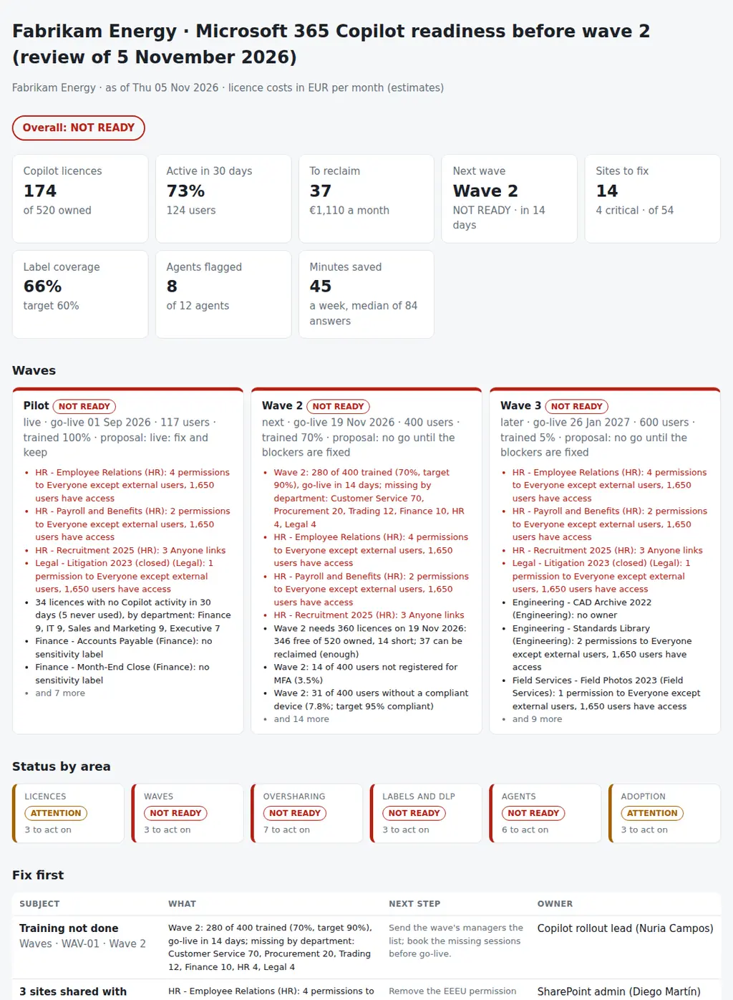

# Microsoft 365 Copilot Readiness Review

The review before each Copilot wave and every month after it: is the tenant ready to give Copilot to the next group of people without exposing what it should not, who is using the licences already paid for, and what has to be fixed before the next wave goes live. From the Entra ID users, the Microsoft 365 Copilot usage report, the SharePoint sites, the label coverage and DLP policies, the Copilot Studio agents and the training records, it puts together:

- **Licences:** licensed users with no Copilot activity in 30 days or never, licences on disabled accounts, the monthly cost of each, and whether the pool covers the next wave once they are reclaimed.
- **Waves:** for each wave, training done, MFA registered, a compliant device and a licence before go-live, and champions in each department.
- **Oversharing:** SharePoint sites shared with *Everyone except external users* or with Anyone links, sites with no owner or one, no sensitivity label, and inactive sites Copilot can still search; Restricted Content Discovery as the stopgap.
- **Labels and DLP:** the share of files with a sensitivity label per department, and whether a DLP policy is enforced on the Microsoft 365 Copilot location.
- **Agents:** agents with no owner, published to the whole organisation, using connectors not on the allowed list or unused, and agents that support decisions about people with no entry in the AI register.
- **Adoption:** active users per department and app, the trend since the last review, champions, and what people say they save.

Nine CSVs, one JSON with the thresholds and the waves, and one Python command give every wave a verdict (**READY**, **ATTENTION** or **NOT READY**), every area a status, and the pack for the Copilot steering group with a decision column per wave: **go, go with conditions, or no go, and what to fix first.**

Python 3.10+, standard library only. It runs with fictional demo data out of the box. A read-only PowerShell exporter for Microsoft Graph and SharePoint Online is included.

It builds on [27-m365-tenant-governance-review](https://github.com/inigogonzalezgarcia/27-m365-tenant-governance-review), the monthly review of admin roles, Conditional Access and tenant settings; this one looks at what Copilot can reach and who uses it. The findings can go as evidence into [25-security-controls-evidence](https://github.com/inigogonzalezgarcia/25-security-controls-evidence).



## Why

Copilot answers from everything a person can already open. A rollout that went well in the pilot can go wrong in the next wave for reasons nobody sees in one console:

- the HR employee relations site has been shared with *Everyone except external users* since a migration, so 1,650 people can open it and Copilot will quote it to any of them;
- the recruitment site has Anyone links and no label, and a closed litigation site has no owner and is still searchable;
- a quarter of Finance's files have a sensitivity label, so the DLP policy that would keep confidential files out of Copilot answers has little to act on, and it is still in simulation;
- an agent published to the whole company was built by someone who left, and it reads from a Dropbox connector nobody approved;
- an HR agent helps screen candidates and is not in the AI register;
- 34 licences have not been used in a month, five never, while wave 2 is 14 licences short;
- wave 2 goes live in two weeks with 70% of its people trained, 14 not registered for MFA and 31 without a compliant device;
- and one department of the next wave has no champion.

Entra ID knows the users, the usage report knows who uses Copilot, SharePoint knows the permissions, Purview knows the labels, the Power Platform inventory knows the agents and the learning platform knows who was trained. The review joins them by person, department and wave. The rules are in `settings.json` and `copilotready/checks.py`.

## What it checks

| Area | Code | Finding |
|---|---|---|
| Licences | LIC-01 | Copilot licences with no activity in `inactive_days` (or never), assigned more than `grace_days` ago, with the monthly cost at `licence_price_month` |
| Licences | LIC-02 | Copilot licences on disabled accounts |
| Licences | LIC-03 | The next wave needs more licences than are free of `licences_owned`: a warning when reclaiming covers it, critical when it does not |
| Waves | WAV-01 | Training under `training_target` (critical under `training_critical` for a wave going live within `readiness_window_days`) |
| Waves | WAV-02 | Users not registered for MFA (critical above `mfa_critical` of the wave) |
| Waves | WAV-03 | Users without a compliant device under `device_target` (critical under `device_critical`) |
| Waves | WAV-04 | Users of a live wave without a licence |
| Oversharing | OVS-01 | Sites with permissions to *Everyone except external users*: critical on a sensitive site (`sensitive_departments`, `sensitive_labels`), information when Restricted Content Discovery is on |
| Oversharing | OVS-02 | Sites with Anyone links (critical on a sensitive site) |
| Oversharing | OVS-03 | Sites with no owner (one owner for information) |
| Oversharing | OVS-04 | Sites with no sensitivity label (a warning on sensitive sites) |
| Oversharing | OVS-05 | Sites with no content change in `inactive_site_days` still searchable by Copilot |
| Labels and DLP | LAB-01 | Departments with label coverage under `label_target` (critical under `label_critical`) |
| Labels and DLP | LAB-02 | No DLP policy enforced on the Microsoft 365 Copilot and Copilot Chat location |
| Agents | AGT-01 | Agents with no owner, or an owner disabled or gone (critical when published to the whole organisation) |
| Agents | AGT-02 | Agents published to the whole organisation |
| Agents | AGT-03 | Agents using connectors not in `allowed_connectors` (critical when published to the whole organisation) |
| Agents | AGT-04 | Published agents not used in `agent_unused_days` |
| Agents | AGT-05 | Agents that support decisions about people with no entry in the AI register (a record, not a legal assessment) |
| Adoption | ADP-01 | Departments with an active-user rate under `adoption_target` |
| Adoption | ADP-02 | Departments whose rate fell more than `adoption_drop` since the last snapshot |
| Adoption | ADP-03 | Departments of a live or next wave with ten or more people and no champion |

Every issue says which waves it reaches: the waves with people in its department, or every wave for critical oversharing and critical agent findings, because any Copilot user who can open the content can get it back in an answer. A wave is NOT READY when a critical issue reaches it, ATTENTION with warnings only, READY otherwise.

## Outputs

| File | What |
|---|---|
| `report.html` | Verdict, tiles (licences, active rate, to reclaim, next wave, sites to fix, label coverage, agents, minutes saved), a card per wave with its blockers, status by area, "Fix first", wave readiness, licences, oversharing, labels, agents, adoption by department and app, and all findings |
| `readiness-pack.md` | The pack for the Copilot steering group: decisions per wave with a proposal and a decision column, headlines, scope and evidence, wave readiness, licences to reclaim, oversharing to fix, labels and DLP, agents, adoption, findings, actions, notes and sign-off |
| `licence-reclaim.csv` | Every licence to reclaim with the user, department, wave, last activity, reason, monthly cost, manager and a decision column |
| `oversharing.csv` | Every site with its department, waves, owners, label, EEEU permissions, Anyone links, users with access, Copilot restrictions, label coverage, severity and action |
| `agents.csv` | Every agent with its owner, audience, connectors (and those not allowed), last use, AI register entry, severity and action |
| `adoption.csv` | Every department with licensed, active users in 30 and 7 days, rate, previous rate, change and champions; append it to `adoption_history.csv` for the next review |
| `waves.csv` | Every wave with its numbers, verdict, proposal, blockers, warnings and a decision column |
| `actions.csv`, `findings.csv` | The findings with owner, waves, monthly cost and next step, ready for a tracker |

## Try it

```bash
git clone https://github.com/inigogonzalezgarcia/44-m365-copilot-readiness.git
cd 44-m365-copilot-readiness
python -m copilotready demo
```

Open `output/report.html` and `output/readiness-pack.md`.

### The demo data

The demo is a made-up energy company, Fabrikam Energy, with 1,800 people in Spain, Portugal and the United Kingdom, reviewed on Thursday 5 November 2026, in euros:

- three waves: a pilot of 120 people live since 1 September (IT, executives, Finance, Sales and Marketing), wave 2 of 400 going live on 19 November (Customer Service, Finance, HR, Procurement, Legal, Trading) and wave 3 of 600 on 26 January;
- 520 Copilot licences bought, 174 assigned; the usage report, 54 SharePoint sites with their label coverage, four DLP policies, 12 agents, the training records, a survey of 84 pilot users and the adoption snapshot of October.

Everything is fictional, and the licence price is a round figure in `settings.json`, not a quote. The problems are placed on purpose among the everyday ones:

- **Licences:** 34 licences inactive for 30 days (five never used) and three on accounts of people who left: 37 to reclaim, €1,110 a month; wave 2 is 14 licences short until they are.
- **Waves:** wave 2 at 70% trained two weeks before go-live (Customer Service 70 people behind), 14 people not registered for MFA and 31 without a compliant device; Trading has no champion.
- **Oversharing:** two HR sites shared with *Everyone except external users* and 1,650 people with access, the recruitment site with Anyone links and no label, a closed litigation site with no owner still searchable; three more sites with EEEU outside the sensitive departments.
- **Labels and DLP:** Finance at 24% label coverage, HR and Field Services under target; the Copilot DLP policy still in simulation.
- **Agents:** *Contract Finder*, published to the whole organisation, owned by a disabled account and reading from Dropbox; a candidate screening agent with no AI register entry; two agents unused.
- **Adoption:** 73% of licensed users active in 30 days; Finance at 50% (down 15 points) and the executives down 12 points since October; a median of 45 minutes saved a week in the survey (self-reported).

The result: every wave **NOT READY** while the HR and Legal sites and the Contract Finder agent are open to everyone, wave 2 also on training, 6 critical findings and 19 warnings, and the verdict NOT READY.

## Use it with your own data

1. Export (read-only):
   ```powershell
   .\scripts\Export-CopilotReadinessData.ps1 -OutputFolder .\data -SharePointAdminUrl https://contoso-admin.sharepoint.com `
       -WaveGroup @{ W1 = '<group id>'; W2 = '<group id>' } -PermissionsReport .\downloads\SitePermissions.csv -IncludeDlp
   ```
   - Microsoft Graph PowerShell: `Get-MgUser` with the assigned licences and plans, `Get-MgSubscribedSku`, `Get-MgGroupMember` (one group per wave), `Get-MgReportAuthenticationMethodUserRegistrationDetail` (MFA) and `Get-MgDeviceManagementManagedDevice` (compliance) for users.csv; `Invoke-MgGraphRequest` with GET on `/copilot/reports/getMicrosoft365CopilotUsageUserDetail` for copilot_usage.csv.
   - SharePoint Online Management Shell: `Get-SPOSite` (label, sharing, last change, Restricted Content Discovery, restricted access control) and the owners, joined to the *Site permissions across your organization* report you download from the SharePoint admin center (EEEU permissions, Anyone links, users with access).
   - Security & Compliance PowerShell: `Get-DlpCompliancePolicy` for dlp.csv.
2. Add by hand: `labels.csv` (Purview content explorer), `agents.csv` (Power Platform admin center, Manage > Inventory, filtered to agents), `training.csv` from the learning platform and, if you ran one, `survey.csv`. Adjust `data/settings.json`: the waves and go-live dates, licences owned and price, sensitive departments, allowed connectors, thresholds and owners ([docs/data-format.md](docs/data-format.md) has every column and setting).
3. Build the outputs:
   ```bash
   python -m copilotready review data/
   ```

[docs/rollout-review.md](docs/rollout-review.md) has the cycle before each wave, the steering group agenda, go or no go per wave, how to fix oversharing before a wave, how to reclaim licences, how to record decisions, and the communication and training steps.

The exports contain names, departments, sites and permissions. Keep them inside your organisation:

- real files at the top level (`users*.csv`, `copilot_usage*.csv`, `sites*.csv`, `labels*.csv`, `dlp*.csv`, `agents*.csv`, `training*.csv`, `survey*.csv`, `adoption_history*.csv`, `settings.json`, `data/`, `downloads/`) and the `output/` folder are excluded from Git by `.gitignore`;
- only the fictional files in `sample_data/` are committed.

## Tests

```bash
pip install -r requirements-dev.txt
python -m pytest -q
```

GitHub Actions runs them on Python 3.10 and 3.12 on every push, then rebuilds the fictional sample data and the report screenshot from the simulator.

14 tests: loading the users, the usage report and the sites with their real column names; inactive, never used and disabled licences and the grace period; the licence pool for the next wave; training, MFA and devices of the next wave; later waves and live waves without licences; EEEU, Anyone links, owners, labels and inactive sites with Restricted Content Discovery and the waves they reach; label coverage and DLP for Copilot; agents (owner, audience, connectors, use, AI register); adoption rate, trend and champions; wave verdicts and the overall verdict; settings overrides; the pack and the CSVs; missing files; and the demo end to end (deterministic, all nine outputs).

## Next steps

- Run the export and the review three weeks and one week before each wave, and on the first Monday of every month after.
- Read the agents straight from the Power Platform inventory API instead of the downloaded list.
- Read the label coverage per site from the Purview content explorer export instead of a compiled file.
- Add the Copilot agents usage report to measure use per agent, not only per user.
- Keep a year of `adoption.csv` to show adoption per department next to the time people say they save.

## Background

Built from my work on Microsoft 365 and its adoption:

- deploying Microsoft 365 Copilot and AI tools for users and driving their adoption, and administering Microsoft 365 agents and Copilot Studio;
- Global Administrator of Microsoft 365, with PIM and just-in-time access, Entra ID Conditional Access, app integration (SAML, SSO, app registrations) and Exchange Online;
- Microsoft Purview, with DLP and sensitivity labels; SharePoint for many years; Power Platform;
- organisational change management (communication, training and adoption plans, impact and stakeholder analysis) with Prosci, ADKAR and Kotter;
- the EU AI Act and responsible AI; business cases with ROI and measurable benefits; workshops with the business, requirements, user stories and acceptance criteria;
- applying ISO 27001, GDPR and NIS2.

Written from scratch with fictional data; no employer data, systems or exports are used.

## Customisation and contact

Want this adapted to your environment? For example:

- your waves, groups and go-live dates, and your thresholds;
- your sensitive departments and labels, your allowed connectors and your AI register;
- your learning platform and survey as the source of training and adoption;
- the pack in the format of your Copilot steering group or change board.

Get in touch:

- Website (contact form): [inigogonzalezgarcia.github.io](https://inigogonzalezgarcia.github.io/about.html#contacto)
- LinkedIn: [linkedin.com/in/igonzalez93](https://www.linkedin.com/in/igonzalez93)

## License

MIT
